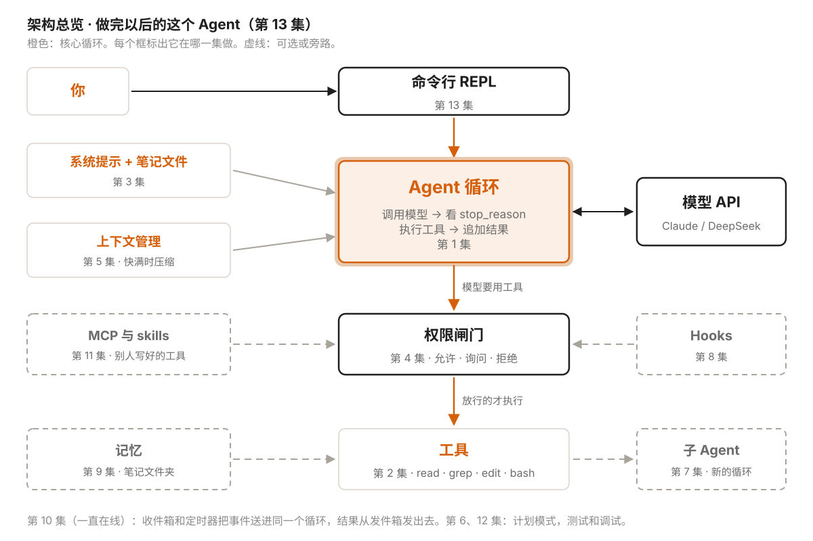

# 从零做一个 Agent（build your own agent）

用 Python，从零做一个 Claude Code 式的命令行 Agent。一集一块，每一集一个文件夹、一个提交：想看哪一步，就切到哪一步。

> **English summary.** A video series and code repo that builds a Claude Code-style coding agent in plain Python, one piece per episode: the loop, tools, prompts, permissions, context, planning, subagents, hooks, memory, always-on, MCP, testing and a finished CLI. Claude Code behavior is taken from its official documentation, never from its source code. The code runs on Claude or DeepSeek (Anthropic-format API).

## 这个项目是什么

很多人用过 Claude Code 这样的工具，但不清楚它到底怎么工作。这个系列用最小的代码，把里面的核心想法一个个做出来：你不需要任何框架，只要会一点 Python。

做完以后，你会得到一个约 500 行的命令行 Agent：能读写文件、在你许可下运行命令、管理自己的上下文、把任务交给子 Agent、跨会话记事。

## 整体架构（做完以后）

<picture>
  <source media="(prefers-color-scheme: dark)" srcset="docs/img/overview-dark.svg">
  
</picture>

中间橙色的是核心循环（第 1 集）。其余每一块都是后面某一集加上去的，框里标了集数。虚线是可选的部分。

## 课程地图

<picture>
  <source media="(prefers-color-scheme: dark)" srcset="docs/img/series-map-dark.svg">
  
</picture>

| 部分 | 集数 | 你会学到 | 介绍 |
|---|---|---|---|
| A 核心 | 1 到 3 | 循环、工具、系统提示和笔记文件 | [part-a-core](docs/part-a-core.md) |
| B 信任和边界 | 4、5 | 权限，上下文管理 | [part-b-trust](docs/part-b-trust.md) |
| C 规模化 | 6 到 8 | 计划，子 Agent，hooks | [part-c-scale](docs/part-c-scale.md) |
| D 跨会话 | 9 到 11 | 记忆，一直在线，MCP 和 skills | [part-d-beyond-one-session](docs/part-d-beyond-one-session.md) |
| E 交付 | 12、13 | 测试和调试，合成一个完整的命令行 | [part-e-ship-it](docs/part-e-ship-it.md) |

完整的每集目标、要做的东西和常见的坑，见 [SYLLABUS.md](SYLLABUS.md)。

## 开始

```bash
pip3 install anthropic
export ANTHROPIC_API_KEY=...        # 在 Anthropic 开发者控制台创建；Claude Pro 订阅不包含 API
python3 ep01/agent.py "这个文件夹里有什么？"
```

不想花钱先看看流程？`python3 ep01/test_loop.py` 用一个假模型把整个循环跑一遍，不需要密钥。

### 换成 DeepSeek

DeepSeek 提供兼容 Anthropic 消息格式的接口，所以同一份代码不用改：

```bash
export DEEPSEEK_API_KEY=...
PROVIDER=deepseek python3 ep01/agent.py "这个文件夹里有什么？"
```

默认是 `PROVIDER=claude`（模型 `claude-haiku-5-5`）。DeepSeek 用 `deepseek-flash`。

## 进度

| 集 | 主题 | 视频 | 代码 |
|---|---|---|---|
| 1 | 循环 | 已发布 | [ep01](ep01/) |
| 2 到 13 | 见课程大纲 | 制作中 | 随每集提交 |

## 约定

- 密钥只放环境变量，不写进代码，也不提交（`.gitignore` 已经挡住 `.env` 文件）。
- 讲 Claude Code 的部分只引用官方文档。文档没写的，我们就说"我们的版本这样做"。
- 每一集的代码先测试再讲，视频里的运行都是真的。

## 许可

MIT，见 [LICENSE](LICENSE)。
