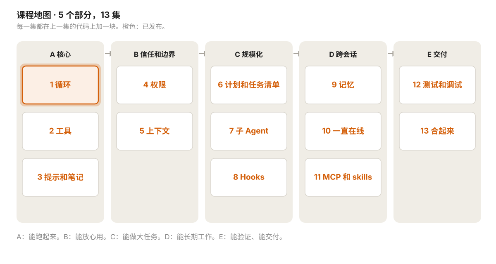

<div align="center">

# Build your own agent

**A Claude Code-style coding agent, written from scratch in plain Python, one piece per episode.**

13 episodes · about 1,500 lines · no framework · every Claude Code claim cited to its docs · every test run for real


</div>

Tools like Claude Code feel like magic until you build one. This repo rebuilds the core ideas in the smallest amount of code: a loop, a few tools, and a few boundaries. Each episode adds one piece, and each piece is one folder and one commit, so you can check out any single step.

## See it work

This is a real, recorded session of the finished agent (episode 13, model: DeepSeek `deepseek-flash`). The `…` marks lines I cut to keep it short. Nothing else is edited.

```text
$ cd ep13/project && python3 ../repl.py
agent chat 20261121-130650-9451  (model deepseek-flash, new)  /help for commands, Ctrl+D to leave
> What does cart.py do? One sentence.
  . run_bash {"command": "ls"} -> allow
  . read_file {"path": "cart.py"} -> allow
`cart.py` defines a simple `Cart` class that collects item prices via `add()` and produces a summary string …
> Which file holds the tax rate?
  . grep {"pattern": "tax|TAX|rate", "path": "."} -> allow
`config.py` — it defines `TAX_RATE = 0.07` (7%), which `pricing.py` imports and applies in `calc_total`.
> Change the tax rate to 8% and update whatever else needs it.
  . load_skill {"name": "pricing-rules"} -> allow
  . read_file {"path": "config.py"} -> allow
  …
  Allow edit_file {"path": "config.py", "old_text": "TAX_RATE = 0.07", "new_text": "TAX_RATE = 0.08"} ?
  [y] once  [a] always this session  [n] no > a
  . edit_file {"path": "config.py", "old_text": "TAX_RATE = 0.07", "new_text": "TAX_RATE = 0.0 -> allow
  …
Tax is now 8% everywhere, and all 6 tests pass.
> List every file you changed in this chat, one path per line, nothing else.
config.py
README.md
CHANGELOG.md
tests/test_pricing.py
> Read every .py file in this folder and describe each one in two sentences.
  Allow run_bash {"command": "find . -name \"*.py\" -not -path \"./.git/*\" | sort"} ?
  [y] once  [a] always this session  [n] no > a
  . run_bash {"command": "find . -name \"*.py\" -not -path \"./.git/*\" | sort"} -> allow
^C[stopped]
> What is the tax rate now? One short answer.
8% (`TAX_RATE = 0.08` in `config.py`).
> /exit
bye

$ python3 ../repl.py --continue
agent chat 20261121-130650-9451  (model deepseek-flash, resumed)  /help for commands, Ctrl+D to leave
> Which file did you read first in this chat? Answer with the path only.
cart.py
```

What you can see in it: streamed answers, a conversation that is kept, a permission question before every edit, a skill loaded on demand, a real Ctrl+C that stops one turn without losing the chat, and a chat that resumes in a new process. The recorder and the recording are in [`ep13/screen/`](ep13/screen/).

## What you will build

At the end you have an agent of about 1,500 lines that:

- runs a **loop** and calls **tools** to read, search and edit files and run commands ([ep 1](articles/ep01-the-loop.md), [ep 2](articles/ep02-tools.md));
- is steered by a short **system prompt** and a project **notes file** ([ep 3](articles/ep03-system-prompt-and-notes.md));
- **asks before it acts**, with allow, ask and deny rules ([ep 4](articles/ep04-permissions.md));
- **manages its own context** in long sessions ([ep 5](articles/ep05-context.md));
- **plans** before it edits and keeps a **task list** ([ep 6](articles/ep06-plan-and-tasks.md));
- hands work to **subagents** ([ep 7](articles/ep07-subagents.md)) and runs your own code in **hooks** ([ep 8](articles/ep08-hooks.md));
- **remembers** things between sessions ([ep 9](articles/ep09-memory.md)) and works **while you are away** ([ep 10](articles/ep10-always-on.md));
- uses tools it did not write through **MCP**, and loads **skills** on demand ([ep 11](articles/ep11-mcp-and-skills.md));
- can be **tested**, so you know whether a change helped ([ep 12](articles/ep12-testing-and-debugging.md));
- and is one **chat** you can use all day, with streaming, saved sessions and Ctrl+C ([ep 13](articles/ep13-putting-it-together.md)).

## Why this series is different

- **The smallest honest version.** No framework. Plain Python and one SDK, so every line is yours to read.
- **Claude Code facts come from its official docs, never from its source code.** Every article names the docs page for its Claude Code claims and lists the pages under References. Where the docs are silent, the article says "our version does it this way".
- **Real tests, including the ones that show nothing.** Every episode's code is tested before it is explained, and the runs on screen are real. We report the null results too: in episode 12 an extra sentence in the rules did *not* help (the baseline already passed 20 of 20 runs), and in episode 11 a hidden instruction in a tool description was seen but never followed in 15 runs, so that test proved nothing about the defences. Samples are small (usually 5 runs per setup), and the articles say so.

## Start here

**Try the finished agent (5 minutes).**

```bash
pip3 install anthropic
export ANTHROPIC_API_KEY=...         # create it in the Anthropic developer console; a Claude Pro plan does not include API access
cd ep13/project                      # a throwaway folder: the agent really runs commands
python3 ../repl.py                   # type a task; /help lists the commands; Ctrl+C stops a turn; Ctrl+D leaves
```

No key yet? `python3 ep13/test_repl.py` runs 38 checks with a fake model, and `python3 ep01/test_loop.py` runs the first loop the same way. Neither needs a key or costs anything.

**Build it from the start.** Read [episode 1](articles/ep01-the-loop.md) and run `python3 ep01/agent.py "What is in this folder?"`. Each article tells you what changed from the previous episode.

**Prefer video?** The videos are in Chinese; the articles are in English. Links are in the table below.

### Use DeepSeek instead of Claude

DeepSeek offers an endpoint that speaks Anthropic's message format, so the same code runs unchanged:

```bash
export DEEPSEEK_API_KEY=...
PROVIDER=deepseek python3 ep01/agent.py "What is in this folder?"
```

The default is `PROVIDER=claude` (model `claude-haiku-5-5`). DeepSeek uses `deepseek-flash`. `ep01/demo/` holds the output of a real run (deepseek-flash) so you can compare with your own, and `ep01/demo-zh/` is the same run with a Chinese prompt, as shown in the Chinese video.

## The 13 episodes

| # | You build | The idea | Read | Code | Watch (中文) |
|---|---|---|---|---|---|
| 1 | The loop | An agent is a loop: ask the model, run the tool it asks for, send the result back | [article](articles/ep01-the-loop.md) | [ep01](ep01/) | Xiaohongshu |
| 2 | Tools | Give the loop hands; a tool description is a prompt, and an error is a result, not a crash | [article](articles/ep02-tools.md) | [ep02](ep02/) | [YouTube](https://youtu.be/aDAciX3ZtKM) |
| 3 | System prompt and notes | Steer the agent with a short prompt and a notes file, and test the change before you keep it | [article](articles/ep03-system-prompt-and-notes.md) | [ep03](ep03/) | [YouTube](https://youtu.be/0eRpVlHqPrU) |
| 4 | Permissions | A gate between "the model asked" and "we run it": allow, ask, deny | [article](articles/ep04-permissions.md) | [ep04](ep04/) | [YouTube](https://youtu.be/IxGgwi45C4I) |
| 5 | Context | Count tokens, clear old results, compact, so long sessions keep working | [article](articles/ep05-context.md) | [ep05](ep05/) | [YouTube](https://youtu.be/pPG8-q1phnY) |
| 6 | Plan mode and task list | Make long tasks visible: plan first with read-only tools, then check items off | [article](articles/ep06-plan-and-tasks.md) | [ep06](ep06/) | [YouTube](https://youtu.be/Nktb_ouBbZA) |
| 7 | Subagents | Protect the main context: a helper with a fresh context returns only its answer | [article](articles/ep07-subagents.md) | [ep07](ep07/) | [YouTube](https://youtu.be/VVIwM-xaIEQ) |
| 8 | Hooks | Run your own code before and after a tool call: allow, block or log | [article](articles/ep08-hooks.md) | [ep08](ep08/) | [YouTube](https://youtu.be/3zCWoypDeVI) |
| 9 | Memory | Remember only what cannot be looked up again, and load a short index at the start | [article](articles/ep09-memory.md) | [ep09](ep09/) | [YouTube](https://youtu.be/W5dlyVRLg44) |
| 10 | Always on | Wake on an event, do one run, save, sleep: an inbox, timers and an outbox | [article](articles/ep10-always-on.md) | [ep10](ep10/) | [YouTube](https://youtu.be/PpgmQ60SvPI) |
| 11 | MCP and skills | Add tools you did not write (MCP) and ways of working (skills), and treat both as outside input | [article](articles/ep11-mcp-and-skills.md) | [ep11](ep11/) | [YouTube](https://youtu.be/xLNg_0Xdj60) |
| 12 | Testing and debugging | One run proves nothing: fixed tasks, a clean copy per trial, a grader on the outcome, one change at a time | [article](articles/ep12-testing-and-debugging.md) | [ep12](ep12/) | [YouTube](https://youtu.be/bruLz7bm0P8) |
| 13 | Putting it together | A chat loop: kept conversation, streaming, saved sessions, Ctrl+C that closes the half turn | [article](articles/ep13-putting-it-together.md) | [ep13](ep13/) | [YouTube](https://youtu.be/yhImrMlX79o) |

The full goals, builds and common pitfalls for each episode are in [SYLLABUS.md](SYLLABUS.md). Every article has the code, real run output, diagrams and inline citations, so you can learn everything in an episode without the video.

## How it fits together

<picture>
  <source media="(prefers-color-scheme: dark)" srcset="docs/img/overview-dark.svg">
  
</picture>

The orange box in the middle is the core loop (episode 1). Every other box is added by a later episode, and the box says which one. Dashed boxes are optional.

The episodes come in five parts. Each part has a short introduction with a diagram.

<picture>
  <source media="(prefers-color-scheme: dark)" srcset="docs/img/series-map-dark.svg">
  
</picture>

| Part | Episodes | You learn | Introduction |
|---|---|---|---|
| A · Core | 1 to 3 | the loop, tools, the system prompt and notes file | [part-a-core](docs/part-a-core.md) |
| B · Trust and limits | 4 and 5 | permissions, context management | [part-b-trust](docs/part-b-trust.md) |
| C · Working at scale | 6 to 8 | plans, subagents, hooks | [part-c-scale](docs/part-c-scale.md) |
| D · Beyond one session | 9 to 11 | memory, always on, MCP and skills | [part-d-beyond-one-session](docs/part-d-beyond-one-session.md) |
| E · Ship it | 12 and 13 | testing and debugging, one finished command-line agent | [part-e-ship-it](docs/part-e-ship-it.md) |

## Repository layout

<picture>
  <source media="(prefers-color-scheme: dark)" srcset="docs/img/repo-layout-dark.svg">
  
</picture>

Each `epNN/` folder holds that episode's agent (`agent.py`, a full copy, so any folder runs on its own), its tests (no key needed), and usually a `demo/` folder with the saved output of its real runs.

## What comes next

Series 1 is finished. A second series is planned: an **enterprise-class agent**, about what changes when many people use one agent (who is who, what it may touch, what happened, what it cost). It is a draft and the details will change. Tell us in the comments on the videos what you want first.

## Ground rules

- Keys live in environment variables only. They are never written into code or committed (the `.gitignore` blocks `.env` files).
- Where I describe Claude Code, I cite its official documentation. Where the docs are silent, I say "our version does it this way".
- Each episode's code is tested before the script is written, so every run on screen is real.
- The agent really runs commands. Use it inside a throwaway folder.

## License

MIT, see [LICENSE](LICENSE).
