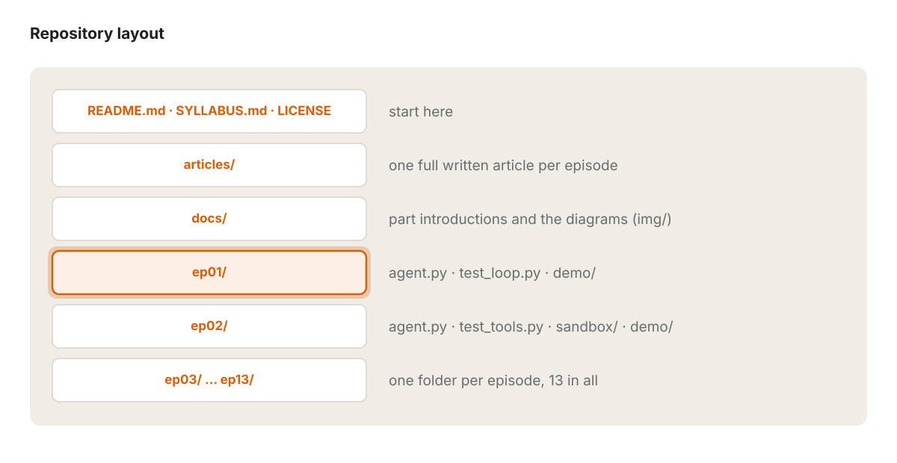

# Build your own agent

A video series and a code repo that build a Claude Code-style command-line agent in plain Python, one piece per episode. Each episode is one folder and one commit, so you can check out any single step.

## What this project is

Many people use tools like Claude Code without knowing how they work. This series rebuilds the core ideas in the smallest amount of code: no framework, just Python and an API key. Claude Code behavior in the videos comes from its official documentation, never from its source code.

At the end you have an agent of about 500 lines that reads and writes files, runs commands with your permission, manages its own context, hands tasks to subagents and remembers things between sessions.

## Architecture of the finished agent

<picture>
  <source media="(prefers-color-scheme: dark)" srcset="docs/img/overview-dark.svg">
  
</picture>

The orange box in the middle is the core loop (episode 1). Every other box is added by a later episode, and the box says which one. Dashed boxes are optional.

## Course map

<picture>
  <source media="(prefers-color-scheme: dark)" srcset="docs/img/series-map-dark.svg">
  
</picture>

| Part | Episodes | You learn | Introduction |
|---|---|---|---|
| A · Core | 1 to 3 | the loop, tools, the system prompt and notes file | [part-a-core](docs/part-a-core.md) |
| B · Trust and limits | 4 and 5 | permissions, context management | [part-b-trust](docs/part-b-trust.md) |
| C · Working at scale | 6 to 8 | plans, subagents, hooks | [part-c-scale](docs/part-c-scale.md) |
| D · Beyond one session | 9 to 11 | memory, always on, MCP and skills | [part-d-beyond-one-session](docs/part-d-beyond-one-session.md) |
| E · Ship it | 12 and 13 | testing and debugging, one finished command-line agent | [part-e-ship-it](docs/part-e-ship-it.md) |

The full goals, builds and common pitfalls for each episode are in [SYLLABUS.md](SYLLABUS.md).

## Get started

```bash
pip3 install anthropic
export ANTHROPIC_API_KEY=...        # create it in the Anthropic developer console; a Claude Pro plan does not include API access
python3 ep01/agent.py "What is in this folder?"
```

Want to see the flow without spending anything? `python3 ep01/test_loop.py` runs the whole loop with a fake model and needs no key.

### Use DeepSeek instead

DeepSeek offers an endpoint that speaks Anthropic's message format, so the same code runs unchanged:

```bash
export DEEPSEEK_API_KEY=...
PROVIDER=deepseek python3 ep01/agent.py "What is in this folder?"
```

The default is `PROVIDER=claude` (model `claude-haiku-5-5`). DeepSeek uses `deepseek-flash`.

`ep01/demo/` holds the output of a real run (model: deepseek-flash) so you can compare with your own; `ep01/demo-zh/` is the same run with a Chinese prompt, as shown in the Chinese video.

## Repository layout

<picture>
  <source media="(prefers-color-scheme: dark)" srcset="docs/img/repo-layout-dark.svg">
  
</picture>

## Articles

Each episode also has a full written article, so you can learn everything in it without the video. Every claim about Claude Code is cited inline with a link to the official page it came from.

| Episode | Article |
|---|---|
| 1 · The loop | [articles/ep01-the-loop.md](articles/ep01-the-loop.md) |
| 2 · Tools | [articles/ep02-tools.md](articles/ep02-tools.md) |

## Progress

| Episode | Topic | Video | Code |
|---|---|---|---|
| 1 | The loop | published | [ep01](ep01/) |
| 2 | Tools | in production | [ep02](ep02/) |
| 3 to 13 | see the syllabus | planned | added with each episode |

## Ground rules

- Keys live in environment variables only. They are never written into code or committed (the `.gitignore` blocks `.env` files).
- Where I describe Claude Code, I cite its official documentation. Where the docs are silent, I say "our version does it this way".
- Each episode's code is tested before the script is written, so every run on screen is real.

## License

MIT, see [LICENSE](LICENSE).
