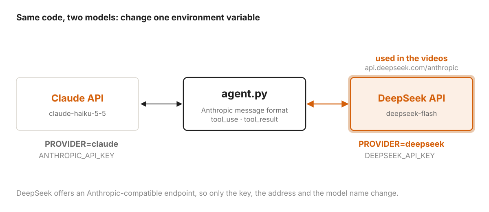
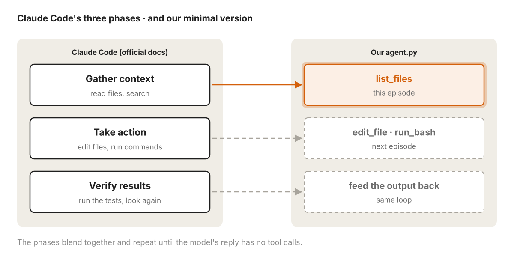
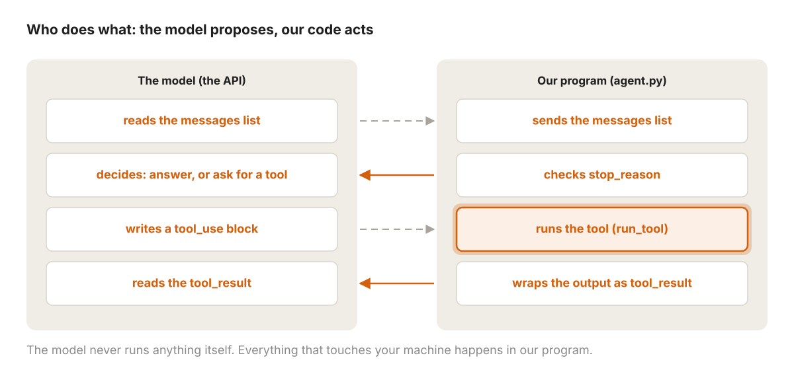
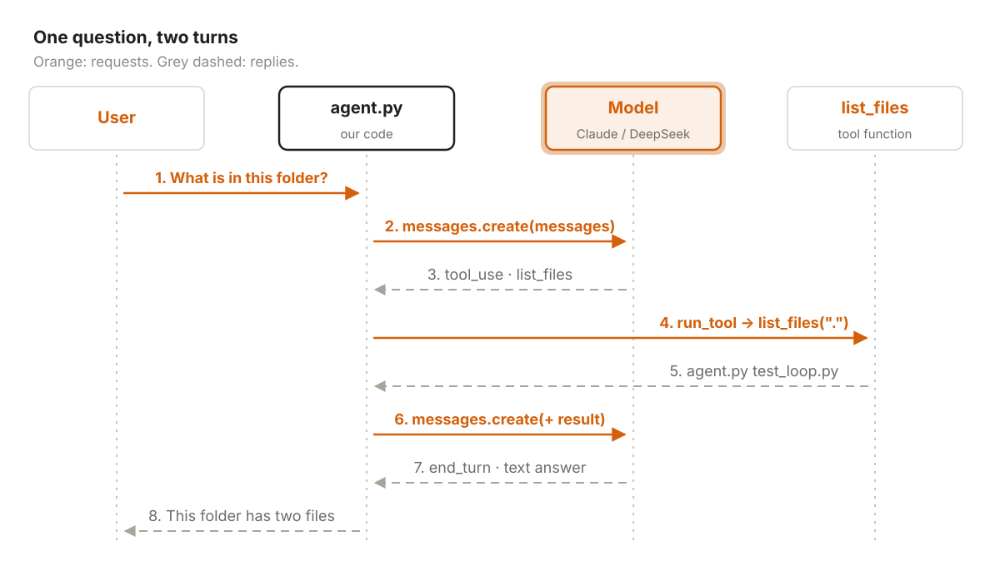
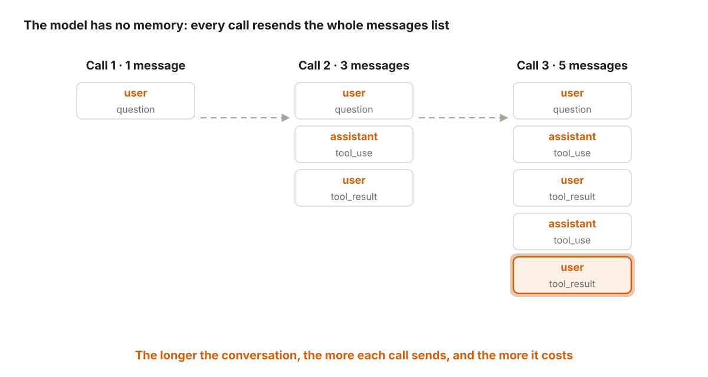
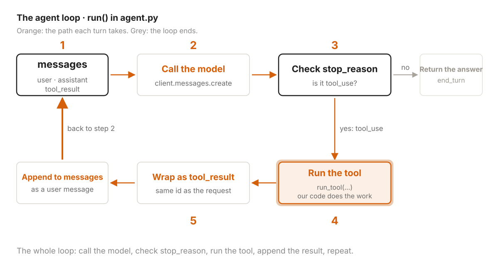

# Episode 1 · The agent loop

*Part A · Core. Video: "从零做 Agent · 第 1 集：循环" (Chinese). Code: [`ep01/`](../ep01/).*

This article is the whole of episode 1 in writing. You do not need the video to follow it: every idea, every line of code and every number used in the video is here, with the page it came from linked inline.

**What you will be able to do afterwards**

- Explain what an agent is, and why its core is a loop.
- Describe what one turn of that loop contains, message by message.
- Write the loop in about 50 lines of Python, run it on a real model, and read its trace.
- Name the three mistakes that break a first agent.

**What you need:** Python 3.9 or newer, a terminal, and an API key for a model that speaks Anthropic's message format.

---

## 1. Why start with a loop

Claude Code can read your files and get work done on its own because there is a loop behind it. Everything else in this series (tools, permissions, memory, subagents) is something you add to that loop. So we build the loop first, in the smallest form that still works, and add one piece per episode.

## 2. Set-up: the key, the model, the cost

You need an API key from a provider. Two points that surprise people:

- **A Claude Pro (or other Claude.ai) subscription does not include API access.** Anthropic treats the paid Claude plans and the Claude Console (the API) as separate products with separate billing; see [Why is Claude API usage billed separately from my paid Claude plan?](https://support.claude.com/en/articles/9876003-why-is-claude-api-usage-billed-separately-from-my-paid-claude-plan). You create a key in the Console and pay for credits there; the quick-start steps are in [Anthropic's get-started guide](https://platform.claude.com/docs/en/get-started).
- **Our code works on more than one provider.** It follows Anthropic's message format, and DeepSeek offers an endpoint that accepts that same format at `https://api.deepseek.com/anthropic` (see [DeepSeek's Anthropic API guide](https://api-docs.deepseek.com/guides/anthropic_api)). So the same file runs on Claude or on DeepSeek by changing one environment variable. The videos in this series demonstrate on DeepSeek's `deepseek-flash` model because it is inexpensive; its prices are on [DeepSeek's pricing page](https://api-docs.deepseek.com/quick_start/pricing).

<picture>
  <source media="(prefers-color-scheme: dark)" srcset="../docs/img/ep01-providers-dark.svg">
  
</picture>

Install the one dependency and set a key (never paste a key into code or a chat; keep it in an environment variable):

```bash
pip3 install anthropic
export ANTHROPIC_API_KEY=...          # or: export DEEPSEEK_API_KEY=... and use PROVIDER=deepseek
```

## 3. What is an agent?

Anthropic's engineering article [Building effective agents](https://www.anthropic.com/engineering/building-effective-agents) describes agents as typically just language models using tools, based on feedback from the environment, in a loop. Three keywords carry the meaning: **model**, **tools**, **loop**.

A chatbot answers once and is done. An agent decides for itself whether to look something up first, reads the result, and then decides what to do next. Think of a new intern: you give them a task, they check the material, do one step, look at the result, and keep going until it is finished.

## 4. How Claude Code describes its own loop

The official page [How Claude Code works](https://code.claude.com/docs/en/how-claude-code-works) splits the work into three phases: **gather context, take action, verify results**. The phases blend together and repeat until the task is done. For a bug fix: reading files is gathering context, editing code is taking action, running the tests is verifying the result.

When does it stop? The Agent SDK documentation, [How the agent loop works](https://code.claude.com/docs/en/agent-sdk/agent-loop), says turns continue until the model produces output with no tool calls, and that the SDK runs the same loop that powers Claude Code. That is the stopping rule we will implement.

<picture>
  <source media="(prefers-color-scheme: dark)" srcset="../docs/img/ep01-three-phases-dark.svg">
  
</picture>

## 5. What happens in one turn

One turn has four steps:

1. We send the user's question (the whole `messages` list) to the model.
2. The model does not answer directly. It replies with a **`tool_use`** block, which means: "please call this tool with these arguments". In our program the model executes nothing; it only makes a request.
3. Our code actually runs the tool and gets a result.
4. We wrap the result in a **`tool_result`** block and send it back. The model reads it and decides: ask for another tool, or answer.

The `tool_use` block has three fields: `id` (the number of this request), `name` (which tool) and `input` (the arguments). The `tool_result` we send back must carry the same id in its `tool_use_id` field, so the model knows which request it answers. When the model makes several requests in one reply, you run all of them and send all the results back together in one message. The API details are on [Handle tool calls](https://platform.claude.com/docs/en/agents-and-tools/tool-use/handle-tool-calls); how a tool is defined is on [Define tools](https://platform.claude.com/docs/en/agents-and-tools/tool-use/define-tools).

Why does the result go in a *user* message? In this API a conversation has only two roles, `user` and `assistant`. The result comes from our side, so it counts as the user side.

<picture>
  <source media="(prefers-color-scheme: dark)" srcset="../docs/img/ep01-who-does-what-dark.svg">
  
</picture>

Here is the real list of four messages after a full run (from a real DeepSeek run; the model's private thinking blocks are left out):

```json
[
  {
    "role": "user",
    "content": "What is in this folder?"
  },
  {
    "role": "assistant",
    "content": [
      {
        "type": "tool_use",
        "id": "call_00_emXpJuljN6VyyJplEhdr2792",
        "name": "list_files",
        "input": {
          "path": "."
        }
      }
    ]
  },
  {
    "role": "user",
    "content": [
      {
        "type": "tool_result",
        "tool_use_id": "call_00_emXpJuljN6VyyJplEhdr2792",
        "content": "agent.py\ndemo\ndemo-zh\ntest_loop.py"
      }
    ]
  },
  {
    "role": "assistant",
    "content": [
      {
        "type": "text",
        "text": "The current folder contains:\n\n- **agent.py**\n- **demo** (folder)\n- **demo-zh** (folder)\n- **test_loop.py**"
      }
    ]
  }
]
```

<picture>
  <source media="(prefers-color-scheme: dark)" srcset="../docs/img/ep01-sequence-dark.svg">
  
</picture>

**The model has no memory of its own.** On every call we send the complete `messages` list again. So the longer a conversation gets, the more each call sends, and the more it costs. A later episode (context management) deals with that.

<picture>
  <source media="(prefers-color-scheme: dark)" srcset="../docs/img/ep01-stateless-dark.svg">
  
</picture>

## 6. The code

The loop is four moves: make a `messages` list; call the model and append its reply; look at `stop_reason`; if it is `tool_use`, run each requested tool, wrap each result, append them as one user message, and go round again. Plus one safety: a turn limit.

<picture>
  <source media="(prefers-color-scheme: dark)" srcset="../docs/img/ep01-loop-dark.svg">
  
</picture>

### The tool

A tool is a name, a description and a schema for its arguments (the function is separate). The model reads the description to decide when to use it.

```python
TOOLS = [{
    "name": "list_files",
    "description": "List the files in a folder.",
    "input_schema": {
        "type": "object",
        "properties": {"path": {"type": "string"}},
    },
}]
```

```python
def list_files(path="."):
    return "\n".join(sorted(os.listdir(path)))
```

When a tool fails, we do not crash the program. We return the error text as the result, and the model can usually find another way.

```python
def run_tool(name, args):
    if name != "list_files":
        return "error: unknown tool"
    try:
        return list_files(**args)
    except Exception as e:
        return "error: %s" % e
```

### The loop

```python
MAX_TURNS = 10

SYSTEM = ("You are a small assistant. "
          "Use tools, then answer briefly.")

def run(task, client, model):
    messages = [{"role": "user", "content": task}]
    for turn in range(1, MAX_TURNS + 1):
        resp = client.messages.create(
            model=model, max_tokens=1024,
            system=SYSTEM, tools=TOOLS,
            messages=messages)
        reply = {"role": "assistant",
                 "content": resp.content}
        messages.append(reply)
        print("turn", turn, resp.stop_reason)
        if resp.stop_reason != "tool_use":
            return messages
        results = []
        for block in resp.content:
            if block.type == "tool_use":
                out = run_tool(block.name,
                               block.input)
                results.append({
                    "type": "tool_result",
                    "tool_use_id": block.id,
                    "content": out})
        messages.append(
            {"role": "user", "content": results})
    return messages
```

Reading it top to bottom:

- `messages` starts with the user's question.
- Each pass calls `client.messages.create(...)`, passing the system prompt, the tool list and the whole `messages` list, then appends the model's reply unchanged.
- `stop_reason` says why the model stopped. We only care whether it is `"tool_use"`. The common values are `end_turn` (the model finished), `tool_use` (it wants a tool) and `max_tokens` (the answer was cut off for length).
- If it is not `tool_use`, the loop ends and we return the conversation.
- If it is, each `tool_use` block is run through `run_tool`, each result is wrapped in a `tool_result` carrying the block's id, and all the results go back in **one** user message.
- `MAX_TURNS` is the safety: without it, a model that keeps calling tools would run (and cost money) forever. The Agent SDK has the same idea as `max_turns`, whose default is no limit; hitting it returns an `error_max_turns` result ([agent loop page](https://code.claude.com/docs/en/agent-sdk/agent-loop)). Anthropic's own article also lists a maximum number of iterations as a common stopping condition ([Building effective agents](https://www.anthropic.com/engineering/building-effective-agents)).

### Choosing the provider

```python
PROVIDERS = {
    "claude": ("ANTHROPIC_API_KEY", None, "claude-haiku-5-5"),
    "deepseek": ("DEEPSEEK_API_KEY",
                 "https://api.deepseek.com/anthropic",
                 "deepseek-flash"),
}


def make_client():
    key, url, model = PROVIDERS[os.environ.get("PROVIDER", "claude")]
    return anthropic.Anthropic(api_key=os.environ[key], base_url=url), model
```

## 7. Run it

```bash
python3 ep01/agent.py "What is in this folder?"
```

The real output (model: `deepseek-flash`):

```text
turn 1 tool_use
turn 2 end_turn
This folder contains:

- `agent.py`
- `demo/`
- `demo-zh/`
- `test_loop.py`
```

Turn 1: the model asks for `list_files`. We run it and send the file names back. Turn 2: it has the names and answers, so `stop_reason` becomes `end_turn` and the loop ends. Two turns, one tool call, and the `messages` list holds four messages (shown above).

Now ask about a folder that does not exist:

```bash
python3 ep01/agent.py "List the files in /nope"
```

```text
turn 1 tool_use
turn 2 end_turn
The directory `/nope` doesn't exist — the listing failed with "No such file or directory." Let me know if you meant a different path.
```

The tool returned an error, and an error is just another kind of result: the model read it and reported it. Printing the stop reason on every turn, as `run()` does, is the most useful habit for understanding an agent.

No API key? Run `python3 ep01/test_loop.py`. It drives the same loop with a fake model, and checks that the tool result is appended, that four messages come out, that errors come back as results, and that the turn limit stops a model that never finishes.

## 8. Three mistakes that break a first agent

1. **The tool result is not sent back correctly.** If the id does not match, or a result is missing, the API will usually return an error.
2. **No turn limit.** The program keeps running and keeps costing money.
3. **Thinking the model executed the code.** In this setup it is *your program* that runs everything, so what is allowed and what is not should be decided by your program. That is exactly what the permissions episode is about; Claude Code's own rules are described on its [permissions page](https://code.claude.com/docs/en/permissions).

## 9. What Claude Code has that ours does not (yet)

Our agent has one tool. Claude Code has tools to read files, edit files and run commands; it asks before dangerous actions; it compacts the conversation when the context is nearly full; and it can hand work to subagents. We add these one at a time in the following episodes. Episode 2 gives the loop real tools.

## 10. Recap

Four things in this episode: the `messages` list, tools, `stop_reason`, and the turn limit. One sentence to remember: **the core of an agent is a loop. Call the model, run the tools, give the results back, until it stops asking for tools.**

### Try it yourself

- Change `MAX_TURNS` to `1` and ask "What is in this folder?". What does the program return, and why?
- Add a second tool, `file_size(path)`, to `TOOLS` and `run_tool`. Does the model use it? What does the model see that makes it choose?
- Delete the `tool_use_id` from the result and run it. What error do you get?

## References

- Anthropic, [Building effective agents](https://www.anthropic.com/engineering/building-effective-agents) (2024-12-19): the definition of an agent used above.
- Claude Code docs, [How Claude Code works](https://code.claude.com/docs/en/how-claude-code-works): the three phases.
- Claude Code docs, [How the agent loop works](https://code.claude.com/docs/en/agent-sdk/agent-loop): when the loop ends, `max_turns`.
- Anthropic API docs, [Define tools](https://platform.claude.com/docs/en/agents-and-tools/tool-use/define-tools) and [Handle tool calls](https://platform.claude.com/docs/en/agents-and-tools/tool-use/handle-tool-calls): `tool_use` and `tool_result`.
- Anthropic API docs, [Get started](https://platform.claude.com/docs/en/get-started) and [Why is API usage billed separately](https://support.claude.com/en/articles/9876003-why-is-claude-api-usage-billed-separately-from-my-paid-claude-plan): keys and billing.
- DeepSeek API docs, [Anthropic API compatibility](https://api-docs.deepseek.com/guides/anthropic_api) and [pricing](https://api-docs.deepseek.com/quick_start/pricing).

*Where this article says what Claude Code does, it comes from the official pages above. Claude Code's source code is not used.*
