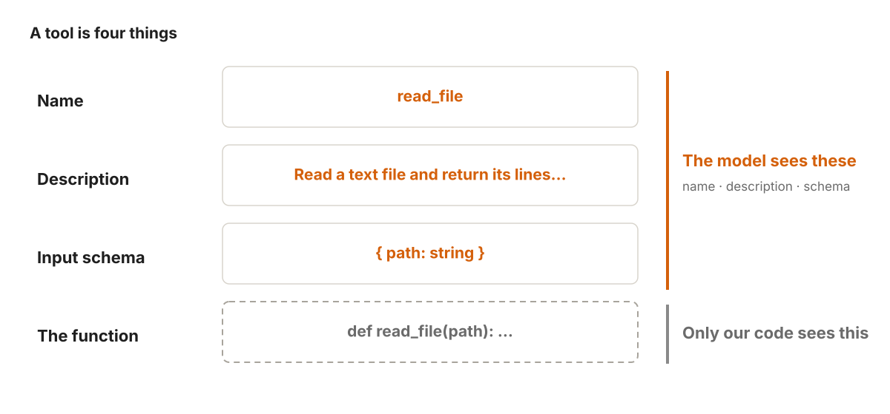
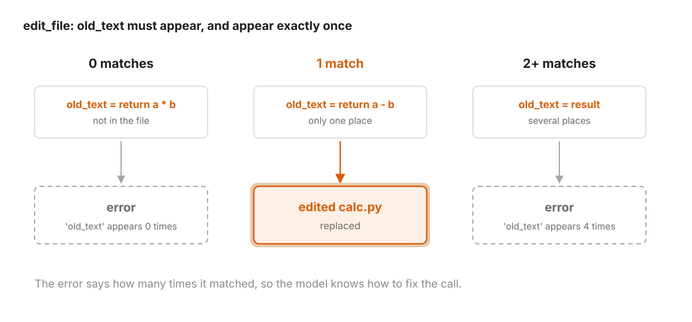
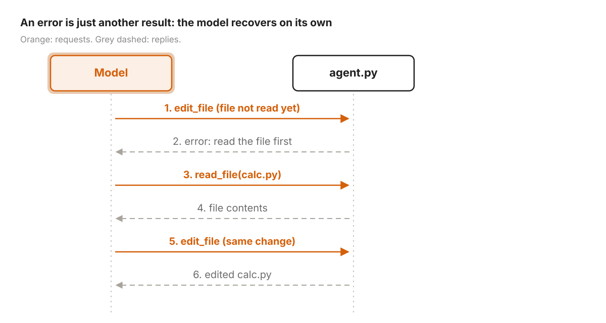
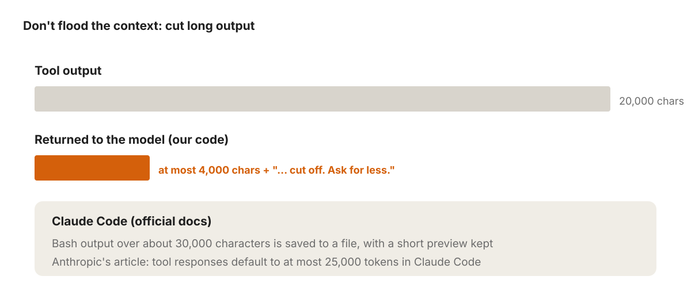
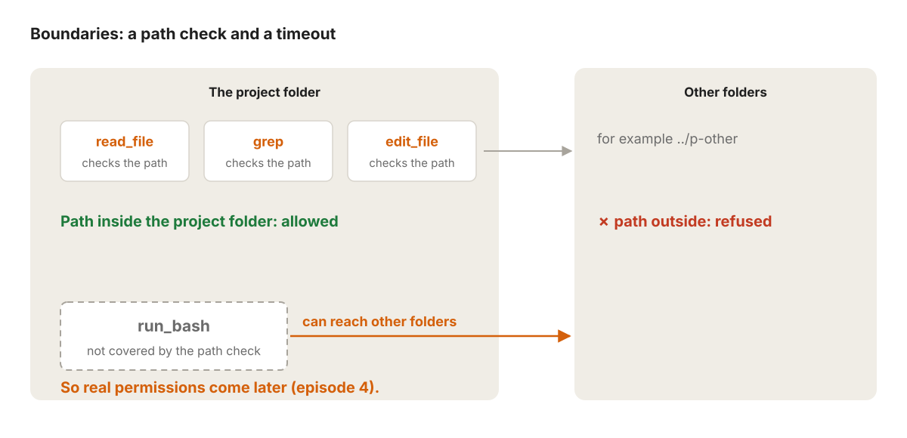
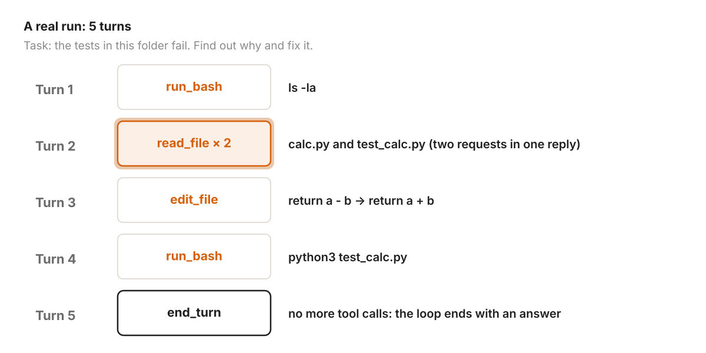
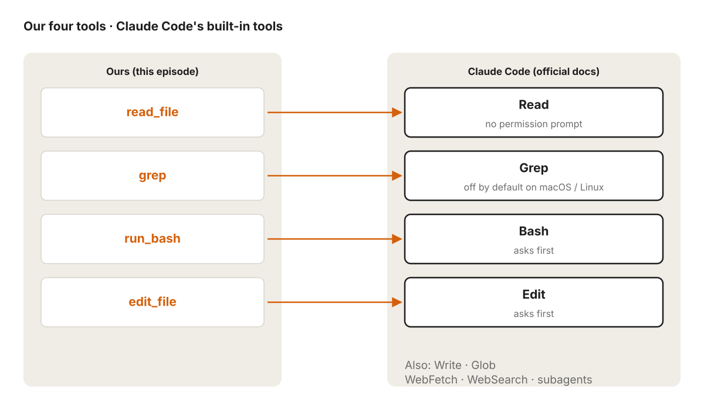

# Episode 2 · Tools

*Part A · Core. Video: "从零做 Agent · 第 2 集：工具" (Chinese). Code: [`ep02/`](../ep02/).*

This article is the whole of episode 2 in writing, so you can follow it without the video. Every claim about Claude Code is taken from the official pages linked inline.

**What you will be able to do afterwards**

- Explain what a tool is from the model's point of view, and write good tool descriptions.
- Build four tools (`read_file`, `grep`, `run_bash`, `edit_file`) and plug them into the loop from episode 1.
- Explain why editing by exact replacement beats rewriting a file, and implement it.
- Apply three design rules: return errors as clear text, keep results short, and enforce boundaries.
- Read a real trace of the agent finding and fixing a bug.

**Before you start:** the loop from [episode 1](ep01-the-loop.md).

> **Safety first.** `run_bash` really runs shell commands, and nothing yet asks before it does. Run this episode only inside a throwaway folder. The permission gate arrives in episode 4.

---

## 1. Recap: tools make the agent

The loop from episode 1 is: call the model, the model asks for a tool, our code runs it, the result goes back. The loop is fixed; the **tools** decide what the agent can do. The better the tools, the more capable the agent.

## 2. What a tool is

A tool has four parts: a **name**, a **description**, an **input schema** (the format of its arguments), and the **function** that does the work. The model never sees the function. It sees only the first three: the name and description decide *when* to use the tool, and the schema decides *how* to fill in the arguments.

<picture>
  <source media="(prefers-color-scheme: dark)" srcset="../docs/img/ep02-tool-anatomy-dark.svg">
  
</picture>

Here is the real definition of our first tool:

```python
    {"name": "read_file",
     "description": (
         "Read a text file and return its lines, "
         "each with a line number. Use it before "
         "you edit a file. Long files are cut "
         "off; use grep to find the part you need."),
     "input_schema": {
         "type": "object",
         "properties": {"path": {"type": "string"}},
         "required": ["path"]}},
```

How long should a description be? Anthropic's API documentation, [Define tools](https://platform.claude.com/docs/en/agents-and-tools/tool-use/define-tools), asks for detailed descriptions: at least three or four sentences covering what the tool does, when to use it and when not to, what each parameter means, and any caveats. Anthropic's engineering article [Writing effective tools for AI agents](https://www.anthropic.com/engineering/writing-tools-for-agents) (2025-09-11) puts it as: write a description the way you would explain the tool to a new hire. It also recommends unambiguous parameter names (for example `user_id` rather than `user`), avoiding tools that overlap, and treating small wording changes in descriptions as something worth testing. In this series the descriptions are deliberately short so that they fit on a phone screen; in a real agent, write more.

## 3. The four tools

Claude Code's built-in tools include Read, Edit, Write and Bash; the table in its [tools reference](https://code.claude.com/docs/en/tools-reference) lists each with a one-line purpose and whether it asks for permission. We build four that cover the same ground: `read_file`, `grep`, `run_bash` and `edit_file`.

### read_file

Reads a text file and returns its lines **with line numbers**. Line numbers matter: the model can say "line 3 is wrong" and later use the text around it in an edit.

```python
def read_file(path):
    full = safe(path)
    with open(full) as f:
        lines = f.read().split("\n")
    READ.add(full)
    body = "\n".join("%d  %s" % (i + 1, l)
                     for i, l in enumerate(lines))
    return cut(body)
```

### grep

Searches a folder for a regular expression and returns `file:line:text` for each match, at most 50.

```python
def grep(pattern, path="."):
    hits = []
    for folder, _, names in os.walk(safe(path)):
        for name in sorted(names):
            file = os.path.join(folder, name)
            try:
                text = open(file).read()
            except (UnicodeDecodeError, OSError):
                continue
            for n, line in enumerate(text.split("\n"), 1):
                if re.search(pattern, line):
                    rel = os.path.relpath(file, ROOT)
                    hits.append("%s:%d:%s" % (rel, n, line))
    return "\n".join(hits[:50]) or "no matches"
```

### run_bash

Runs one shell command in the project folder and returns its output and exit code. It stops after 20 seconds.

```python
def run_bash(command):
    done = subprocess.run(
        command, shell=True, cwd=ROOT, timeout=20,
        capture_output=True, text=True)
    out = cut(done.stdout + done.stderr)
    return "exit code %d\n%s" % (done.returncode, out)
```

For comparison, the [tools reference](https://code.claude.com/docs/en/tools-reference) says Claude Code's Bash tool has a default timeout of two minutes. Remember the safety note above: this tool does exactly what the model asks.

### edit_file

Replaces one exact piece of text in a file. It has three parameters: `path`, `old_text` and `new_text`. The rules: the file must have been read first, and `old_text` must appear **exactly once**.

```python
    {"name": "edit_file",
     "description": (
         "Replace one exact piece of text in a "
         "file. 'old_text' must match it exactly "
         "and appear once, so include enough "
         "surrounding text. Read the file first."),
     "input_schema": {
         "type": "object",
         "properties": {"path": {"type": "string"},
                        "old_text": {"type": "string"},
                        "new_text": {"type": "string"}},
         "required": ["path", "old_text", "new_text"]}},
```

```python
def edit_file(path, old_text, new_text):
    full = safe(path)
    if full not in READ:
        raise ToolError("read the file first")
    text = open(full).read()
    n = text.count(old_text)
    if n != 1:
        raise ToolError("'old_text' appears %d times; "
                        "it must appear once" % n)
    open(full, "w").write(
        text.replace(old_text, new_text))
    return "edited " + path
```

## 4. Why edit by exact replacement?

You could let the model rewrite a whole file. That is slow and expensive (it must output the entire file) and risky (it can change lines it was not asked to touch). Exact replacement needs only the one piece that changes.

Claude Code's Edit tool works the same way. Per its [tools reference](https://code.claude.com/docs/en/tools-reference), it performs exact string replacement, with no regular expressions and no fuzzy matching; the old text must appear exactly once unless you explicitly ask to replace all occurrences; and some models are required to read the file before editing it. Our version adds two matching rules: *not read yet* is refused, and *0 or many matches* is refused, with the number of matches in the message.

<picture>
  <source media="(prefers-color-scheme: dark)" srcset="../docs/img/ep02-edit-match-dark.svg">
  
</picture>

## 5. Design rule 1: an error is just another result

When a tool fails, do not crash the program. Turn the failure into a clear sentence and send it back. Anthropic's tool-writing article ([Writing effective tools for AI agents](https://www.anthropic.com/engineering/writing-tools-for-agents)) recommends error messages that tell the model what to do differently, rather than an opaque code or a traceback.

The API has a field for this: `is_error` on the `tool_result` block. Set it to true and the model knows the call failed; see [Handle tool calls](https://platform.claude.com/docs/en/agents-and-tools/tool-use/handle-tool-calls). Our loop does this:

```python
class ToolError(Exception):
    """A problem the model can fix by trying again."""


def run_tool(name, args):
    """Returns (text, is_error). An error is a result too."""
    try:
        return FUNCS[name](**args), False
    except subprocess.TimeoutExpired:
        return "error: the command took too long", True
    except Exception as e:
        return "error: %s" % e, True
```

Here is the real error block from a run (the run is shown next):

```json
{
  "type": "tool_result",
  "tool_use_id": "call_00_XHlYL2Au9amsExbuEj1L1068",
  "content": "error: read the file first",
  "is_error": true
}
```

**A real recovery.** To show this working, I deliberately gave the agent the task *"Do not read the file first: call edit_file right away to change `return a - b` to `return a + b` in calc.py. If it fails, recover."* So the blind edit was my instruction, not the model's idea. Real output (model: `deepseek-flash`):

```text
turn 1 tool_use
  edit_file {"path": "calc.py", "old_text": "return a - b", "new_text": "return a + b"}
turn 2 tool_use
  read_file {"path": "calc.py"}
turn 3 tool_use
  edit_file {"path": "calc.py", "old_text": "    return a - b", "new_text": "    return a + b"}
turn 4 end_turn
The first attempt failed ("read the file first"), so I read `calc.py`, then applied the edit successfully. Line 3 now returns `a + b`.
```

Turn 1: the edit fails with *read the file first*. Turn 2: the model reads the file. Turn 3: it repeats the edit and it works. No crash, no human needed: the error message was the guidance.

<picture>
  <source media="(prefers-color-scheme: dark)" srcset="../docs/img/ep02-error-recovery-dark.svg">
  
</picture>

## 6. Design rule 2: do not flood the context

A 50,000-line file, or a command that prints a flood of text, would fill the model's context window. So our tools cut long output:

```python
def cut(text, limit=MAX_CHARS):
    if len(text) <= limit:
        return text
    return text[:limit] + "\n... cut off. Ask for less."
```

`read_file` and `run_bash` pass their output through `cut()`: anything over 4,000 characters is dropped and the model is told to ask for less. `grep` is capped at 50 matches instead.

Anthropic's article recommends truncating with sensible defaults and, when you truncate, steering the model toward a narrower follow-up call; it also says Claude Code limits tool responses to 25,000 tokens by default ([source](https://www.anthropic.com/engineering/writing-tools-for-agents)). The Claude Code tools reference adds that Bash output beyond roughly 30,000 characters is saved to a file with a short preview kept ([source](https://code.claude.com/docs/en/tools-reference)). Ours is the simple version: our hint is only "Ask for less", and `read_file` has no offset or limit, so the model would use `grep` to find the part it needs, as our description tells it to.

<picture>
  <source media="(prefers-color-scheme: dark)" srcset="../docs/img/ep02-truncation-dark.svg">
  
</picture>

## 7. Design rule 3: enforce boundaries

Two limits in our code:

```python
def safe(path):
    full = os.path.realpath(os.path.join(ROOT, path))
    if full != ROOT and not full.startswith(ROOT + os.sep):
        raise ToolError("path is outside the project folder")
    return full
```

`read_file`, `grep` and `edit_file` call `safe()`, so a path that resolves outside the project folder is refused. (A bug found in review: the check must compare against `ROOT + os.sep`, otherwise a sibling folder like `/proj-other` slips through when the project is `/proj`. The test file covers that case.) And `run_bash` has a 20-second timeout.

**What this does not do:** `run_bash` is **not** covered by the path check. A command can read or delete files anywhere you have access. That is why real permissions come later in the series.

<picture>
  <source media="(prefers-color-scheme: dark)" srcset="../docs/img/ep02-boundary-dark.svg">
  
</picture>

## 8. A real run

The task: the tests in a small project fail; find out why and fix it. The project has a deliberately broken function:

```python
def add(a, b):
    """Add two numbers."""
    return a - b


def total(numbers):
    result = 0
    for n in numbers:
        result = add(result, n)
    return result
```

and a test:

```python
from calc import add, total

assert add(2, 3) == 5, "add(2, 3) should be 5"
assert total([1, 2, 3]) == 6, "total([1, 2, 3]) should be 6"
print("all tests passed")
```

Run it (inside a copy of `ep02/sandbox`):

```bash
PROVIDER=deepseek python3 ../agent.py "The tests in this folder fail. Find out why and fix it."
```

The real output:

```text
turn 1 tool_use
  run_bash {"command": "ls -la"}
turn 2 tool_use
  read_file {"path": "calc.py"}
  read_file {"path": "test_calc.py"}
turn 3 tool_use
  edit_file {"path": "calc.py", "old_text": "    return a - b", "new_text": "    return a + b"}
turn 4 tool_use
  run_bash {"command": "python3 test_calc.py"}
turn 5 end_turn
**Cause:** `add()` in `calc.py` was implemented as `return a - b` instead of `return a + b`. That broke both assertions — `add(2, 3)` returned `-1`, and `total()` built its sum on top of the same broken `add`, so it returned `-6` for `[1, 2, 3]`.

**Fix:** Changed line 3 to `return a + b`. All tests now pass.
```

Turn by turn:

1. The model runs `ls -la` to see what is in the folder.
2. It asks for **two** things in one reply: read `calc.py` and read `test_calc.py`. (One reply can contain several `tool_use` blocks, as in episode 1.)
3. Having read both, it edits `calc.py`, replacing `return a - b` with `return a + b`.
4. It runs the tests to confirm.
5. It makes no further tool call, so the loop ends with its answer.

<picture>
  <source media="(prefers-color-scheme: dark)" srcset="../docs/img/ep02-run-trace-dark.svg">
  
</picture>

Model runs vary from run to run (an earlier run of the same task ran the tests first and also used `grep`); what stays constant is the loop.

## 9. Compared with Claude Code

<picture>
  <source media="(prefers-color-scheme: dark)" srcset="../docs/img/ep02-compare-dark.svg">
  
</picture>

From the [tools reference](https://code.claude.com/docs/en/tools-reference): Read does not ask for permission; Edit, Write and Bash do. Grep and Glob are absent by default on macOS, Linux and WSL, where Claude uses `grep` and `find` through Bash instead. Claude Code also has more tools than ours (Write, Glob, WebFetch, WebSearch, subagents and others). How its permission modes and rules work is on the [permissions page](https://code.claude.com/docs/en/permissions); we build our own version in episode 4.

## 10. Three design pitfalls

1. **Too many, overlapping tools.** The model picks the wrong one. Anthropic's advice is a few well-chosen tools, with related actions consolidated ([source](https://www.anthropic.com/engineering/writing-tools-for-agents)).
2. **Vague descriptions.** The model does not know when to use the tool.
3. **Vague parameter names.** `user` versus `user_id` means different things to the model; write names that cannot be misread.

(Our own `edit_file` started with parameters `old` and `new`, which are weak names. They became `old_text` and `new_text`.)

## 11. Recap

Four things to remember:

1. A tool's description is written for the model.
2. Edit by exact replacement: change only one place.
3. When a tool fails, return a clear error as the result.
4. Keep results short, and put a timeout on commands.

**Next:** episode 3 gives the agent a system prompt and a notes file so it understands your project.

### Try it yourself

- Make `read_file` accept optional `start` and `limit` line numbers, and mention them in its description. Does the model use them on a long file?
- Ask the agent to change a word that occurs several times. What does `edit_file` return, and what does the model do next?
- Write a longer, richer description for `grep` (three or four sentences, following the API guidance above). Does the model choose it more often than `run_bash` with `grep`?
- Run `python3 ep02/test_tools.py`. Which test would fail if you removed the `ROOT + os.sep` fix?

## References

- Claude Code docs, [Tools reference](https://code.claude.com/docs/en/tools-reference): the built-in tools, Edit's exact string replacement, Bash timeout and output handling, Grep/Glob availability.
- Anthropic, [Writing effective tools for AI agents](https://www.anthropic.com/engineering/writing-tools-for-agents) (2025-09-11): descriptions, parameter names, consolidating tools, truncation, error messages.
- Anthropic API docs, [Define tools](https://platform.claude.com/docs/en/agents-and-tools/tool-use/define-tools): tool definitions and description guidance.
- Anthropic API docs, [Handle tool calls](https://platform.claude.com/docs/en/agents-and-tools/tool-use/handle-tool-calls): `tool_result` and `is_error`.
- Claude Code docs, [Permissions](https://code.claude.com/docs/en/permissions): how Claude Code decides what to ask about (our version comes in episode 4).

*Where this article says what Claude Code does, it comes from the official pages above. Claude Code's source code is not used.*
