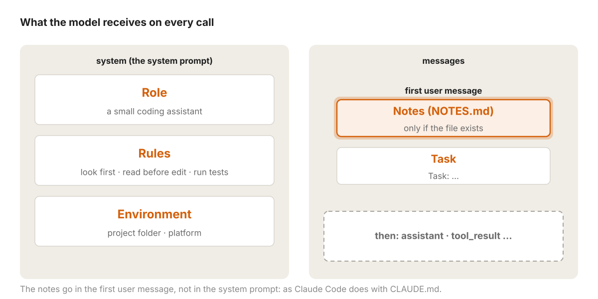
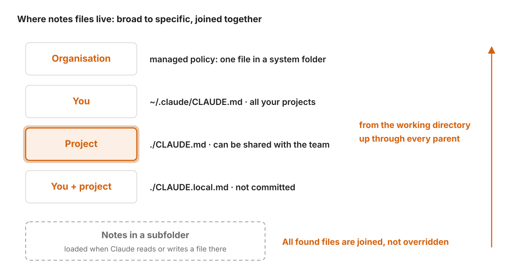
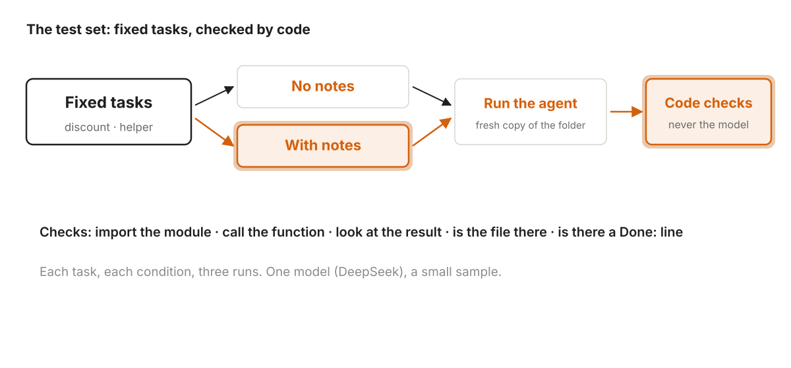
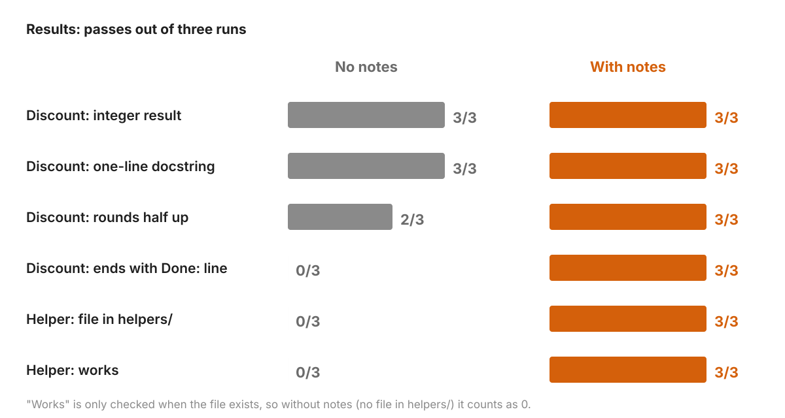
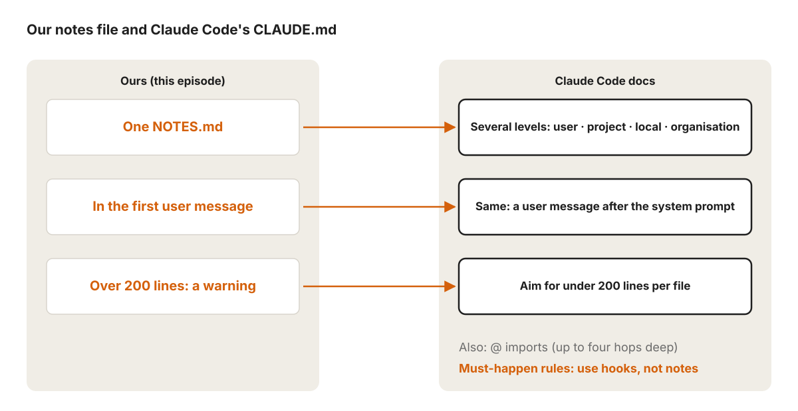

# Episode 3 · The system prompt and the notes file

*Part A · Core. Video: "Build your own agent · 03: system prompt". Code: [`ep03/`](../ep03/).*

This article is the whole of episode 3 in writing, so you can follow it without the video. Every claim about Claude Code is taken from the official pages linked inline. Where the docs are silent, I say "our version does it this way".

**What you will be able to do afterwards**

- Explain what the system prompt is and what goes into it: a role, a few rules, the environment.
- Add a project notes file that is loaded at the start of every run, and say where it goes in the request.
- Print exactly what the model receives, so you can debug a prompt.
- Write notes that help: short, specific, checkable, and only what the code cannot tell the model.
- Test a prompt change with a small fixed set of tasks and checks written as code.

**Before you start:** the agent with four tools from [episode 2](ep02-tools.md). Run everything inside a throwaway folder: `run_bash` is still unguarded until episode 4.

---

## 1. Recap: tools, but no knowledge of your project

After episode 2 the agent can read, search, edit and run commands. What it does not have is any knowledge of *your* project. Every run it starts from nothing: it lists the folder, reads a few files and guesses your conventions. This episode fixes that without touching the model. We steer it with two things: a **system prompt** and a **notes file**.

## 2. The system prompt

The system prompt is a separate parameter of the API call, called `system`, next to `messages`. It is sent with every call. Anthropic's prompting guide says that [setting a role in the system prompt focuses Claude's behavior and tone for your use case](https://platform.claude.com/docs/en/build-with-claude/prompt-engineering/system-prompts), and its example is a one-line role.

Our system prompt has three parts: a role, a few rules, and the environment.

<picture>
  <source media="(prefers-color-scheme: dark)" srcset="../docs/img/ep03-what-model-receives-dark.svg">
  
</picture>

In code (`ep03/agent.py`):

```python
# The system prompt has three parts: a role, a few rules, the environment.
ROLE = "You are a small coding assistant working in a project folder."
RULES = ("Use the tools to look, then act. Read a file before you edit it. "
         "Check your work by running the tests. Answer briefly.")


def environment():
    return "Project folder: %s\nPlatform: %s" % (ROOT, sys.platform)


def build_system():
    return "%s\n\n%s\n\n%s" % (ROLE, RULES, environment())
```

The role says who the model is. The rules are habits that hold for every project. The environment is facts about this run. Anything specific to one project does not belong here.

## 3. The notes file

Project conventions change from project to project, so they go in a file inside the project. Claude Code calls it `CLAUDE.md`. Our version calls it `NOTES.md`.

### Where Claude Code looks

According to the [Memory page of the Claude Code docs](https://code.claude.com/docs/en/memory), the files are, in load order from the broadest scope to the most specific:

- **Managed policy:** one file in a system folder (on macOS `/Library/Application Support/ClaudeCode/CLAUDE.md`).
- **User:** `~/.claude/CLAUDE.md`, personal preferences for all projects.
- **Project:** `./CLAUDE.md` or `./.claude/CLAUDE.md`, shared with the team.
- **Local:** `./CLAUDE.local.md`, personal preferences for one project; the docs say to add it to `.gitignore`.

<picture>
  <source media="(prefers-color-scheme: dark)" srcset="../docs/img/ep03-notes-locations-dark.svg">
  
</picture>

The same page explains the loading rules. Claude Code loads `CLAUDE.md` and `CLAUDE.local.md` from the working directory and every directory above it, ordered from the filesystem root down. A `CLAUDE.md` in a subdirectory is loaded once Claude reads, writes or edits a file in that subdirectory. All the files found are concatenated into context; they do not override each other.

### Where the notes go in the request

This detail is easy to get wrong. The same page says: "CLAUDE.md content is delivered as a user message after the system prompt, not as part of the system prompt itself." It also says Claude treats the file as context, not enforced configuration.

Our version does the same. The notes go into the first user message, followed by the task:

```python
def first_message(task, notes):
    """Notes go in the first user message, not in the system prompt.
    (Claude Code does the same with CLAUDE.md.)"""
    if not notes:
        return task
    return "Project notes (%s):\n%s\n\nTask: %s" % (NOTES_FILE, notes, task)
```

And `load_notes()` reads the file at the start of a run, or returns an empty string if there is none:

```python
def load_notes():
    """The project notes, or "" if there is no notes file."""
    path = os.path.join(ROOT, NOTES_FILE)
    if not os.path.exists(path):
        return ""
    text = open(path).read()
    n = len(text.split("\n"))
    if n > NOTES_MAX_LINES:
        print("warning: %s has %d lines; long notes get followed less"
              % (NOTES_FILE, n))
    return text
```

### See what the model sees

When a prompt misbehaves, the first step is to look at what was really sent. `python3 agent.py --show-prompt` prints it (this is real output from `ep03/sandbox`):

```text
--- system ---
You are a small coding assistant working in a project folder.

Use the tools to look, then act. Read a file before you edit it. Check your work by running the tests. Answer briefly.

Project folder: .../ep03/sandbox
Platform: darwin
--- first message ---
Project notes (NOTES.md):
# Project notes

- Money is integer cents. Never use floats for money.
- A percent discount rounds half up, so 50% off 1005 is 503.
- Every function gets a one-line docstring.
- New helper code goes in the helpers/ folder, one function per file, the file named after the function.
- End your last message with one line that starts with "Done:" and says what changed.


Task: <your task>
```

(Claude Code has the equivalent: the docs say to run `/context all` to confirm a file loaded.)

## 4. What to put in the notes

The docs give several pieces of advice. They come from two pages, the [Memory page](https://code.claude.com/docs/en/memory) and [Best practices](https://code.claude.com/docs/en/best-practices):

1. **Keep it short.** The target is under 200 lines per file; longer files consume more context and reduce adherence. Our loader prints a warning above 200 lines.
2. **Write only what Claude could not work out from the code.** The best-practices page gives a test: could it find this by reading the code? If yes, leave it out. Worth keeping: the exact test and lint commands, misleading patterns, decisions that are not in the repo.
3. **Be concrete enough to verify.** The Memory page prefers "Run npm test before committing" to "Test your changes", and "Use 2-space indentation" to "format code nicely".
4. **Add a line when the same mistake happens a second time.** The Memory page gives that as the moment to add to the file.
5. **Start from `/init`.** In Claude Code, `/init` generates a starting `CLAUDE.md`; if one exists it suggests improvements instead of overwriting.

Our notes file has five lines:

```markdown
# Project notes

- Money is integer cents. Never use floats for money.
- A percent discount rounds half up, so 50% off 1005 is 503.
- Every function gets a one-line docstring.
- New helper code goes in the helpers/ folder, one function per file, the file named after the function.
- End your last message with one line that starts with "Done:" and says what changed.
```

Every line is concrete, and none of them can be learned from a tiny project by reading it.

## 5. Does it help? A small fixed test set

"It feels better" is not evidence. `ep03/evals.py` runs two fixed tasks, each with and without the notes file, three times each, in a fresh copy of the sandbox folder:

- **discount:** "Add a function `apply_discount(cents, percent)` to `pricing.py`."
- **helper:** "Add a helper `round_down_5(cents)` that rounds a price down to a multiple of 5 cents."

<picture>
  <source media="(prefers-color-scheme: dark)" srcset="../docs/img/ep03-eval-flow-dark.svg">
  
</picture>

The checks are plain code. For the discount task it imports the module and calls the function: is the result an integer, does 50% off 1005 give 503, is there a docstring. For the helper task it looks for `helpers/round_down_5.py` and calls the function. For both it checks that the last message has a `Done:` line.

Real results with `deepseek-flash` (`ep03/demo/evals.txt`), passes out of three runs:

```text
no notes   discount  Done: line 0, docstring 3, integer result 3, rounds half up 2
no notes   helper    Done: line 0, file in helpers/ 0, works 0
with notes discount  Done: line 3, docstring 3, integer result 3, rounds half up 3
with notes helper    Done: line 3, file in helpers/ 3, works 3
```

<picture>
  <source media="(prefers-color-scheme: dark)" srcset="../docs/img/ep03-results-dark.svg">
  
</picture>

How to read this honestly:

- The notes clearly changed two things: the model followed the folder rule and the `Done:` line only when it had the notes (0 of 3, then 3 of 3). Those rules cannot be guessed.
- Integer results and docstrings were already right without notes (3 of 3 both ways). The model does that by itself.
- Rounding half up was 2 of 3 without notes and 3 of 3 with. That is one run apart and could be luck.
- "Works" is only checked when the file exists, so without notes (no file in `helpers/`) it counts as 0.
- This is one model, three runs per cell. It shows the method, not a general result.

### One real run

Here is the helper task without notes (`ep03/demo/run-no-notes.txt`, shortened): the function went into `pricing.py`, with no docstring and no `Done:` line.

```text
turn 1 tool_use
  run_bash {"command": "ls -la"}
turn 2 tool_use
  read_file {"path": "pricing.py"}
  read_file {"path": "check.py"}
turn 3 tool_use
  edit_file {"path": "pricing.py", ...}
...
def round_down_5(cents):
    return cents - cents % 5
--- files ---
./check.py
./pricing.py
```

With notes (`ep03/demo/run-with-notes.txt`, shortened) it created `helpers/round_down_5.py` with a one-line docstring and ended with a `Done:` line:

```text
turn 3 tool_use
  run_bash {"command": "mkdir -p helpers && touch helpers/__init__.py && cat > helpers/round_down_5.py ..."}
...
def round_down_5(cents):
    """Round an integer number of cents down to the nearest multiple of 5 cents."""
    return cents - (cents % 5)
Done: added `helpers/round_down_5.py` with the `round_down_5(cents)` helper ...
--- files ---
./check.py
./helpers/__init__.py
./helpers/round_down_5.py
./pricing.py
```

### What went wrong the first time

Testing surfaced two problems that were not about the model.

1. `max_tokens` was 1024, too small: one run ended with `max_tokens` before the model finished. I raised it to 2048.
2. My notes rule "new helper code goes in the helpers/ folder" was written too broadly. In the discount task the model put the small rounding function into `helpers/` as well, which followed the rule. My check imported `pricing.py` without the folder on the path, so it crashed with `ModuleNotFoundError` and reported a failure. The broken part was the check, not the model. I fixed the check to import the module the way the project does.

Two lessons: a check is code too and needs testing, and one rule can change behaviour in a task you did not have in mind. A fixed test set is how you notice.

## 6. Compared with Claude Code

<picture>
  <source media="(prefers-color-scheme: dark)" srcset="../docs/img/ep03-compare-dark.svg">
  
</picture>

- **Levels.** Claude Code has managed, user, project and local files, plus subdirectory files. We have one.
- **Imports.** A `CLAUDE.md` can pull in other files with `@path/to/file`; imported files can import others, to a maximum depth of four hops. We have none.
- **Hooks for must-happen rules.** The docs say CLAUDE.md is guidance, not enforcement: Claude is allowed to decide a guideline does not apply, and a rule that must happen every time belongs in a hook. Hooks come later in the series.

## 7. Three pitfalls

1. **Notes that grow too long.** The Memory page says longer files consume more context and reduce adherence. Trim; do not pile on.
2. **Rules that are vague or that the model cannot check.** "Write good code" gives nothing to act on. Write rules you can verify, such as the commands to run.
3. **Changing the prompt without testing it again.** A small fixed set of tasks with code checks costs little and catches surprises like the one above.

## 8. Recap

1. The system prompt holds a role, a few rules and the environment.
2. Project conventions go in a notes file, delivered as the first user message.
3. Keep notes short and concrete, and write only what the code cannot tell the model.
4. After changing a prompt, re-run a fixed set of tasks with checks written as code.

**Next:** episode 4 adds a permission gate between "the model asked" and "we run it".

**Try it:** run `python3 agent.py --show-prompt` in the sandbox, then change one line of `NOTES.md` and run `python3 evals.py 1`. Which check changes?

## References

- Claude Code docs, Memory (CLAUDE.md locations, loading, imports, length, `/init`): https://code.claude.com/docs/en/memory
- Claude Code docs, Best practices (what to put in CLAUDE.md, guidelines versus hooks): https://code.claude.com/docs/en/best-practices
- Anthropic docs, Prompting best practices (giving Claude a role in the system prompt): https://platform.claude.com/docs/en/build-with-claude/prompt-engineering/system-prompts
- Code and real runs in this repository: [`ep03/agent.py`](../ep03/agent.py), [`ep03/evals.py`](../ep03/evals.py), [`ep03/demo/`](../ep03/demo/)
