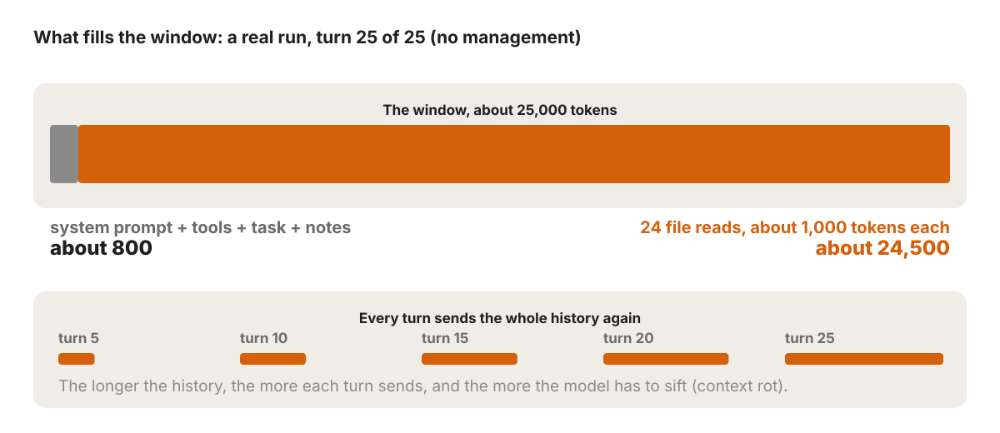
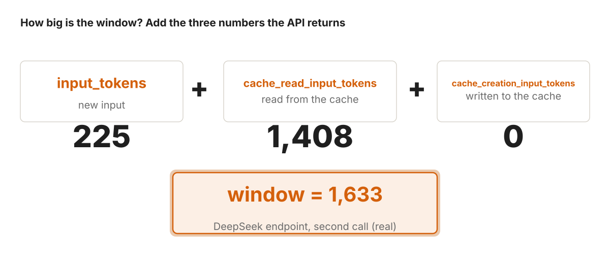
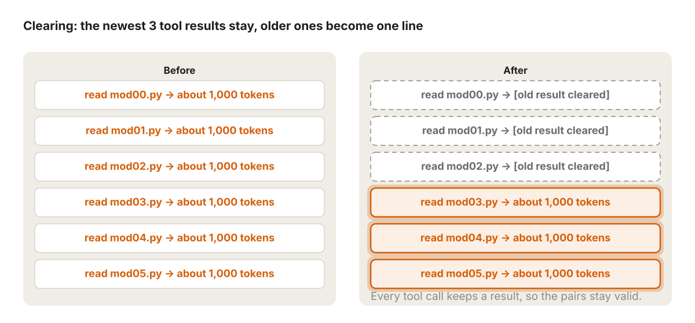
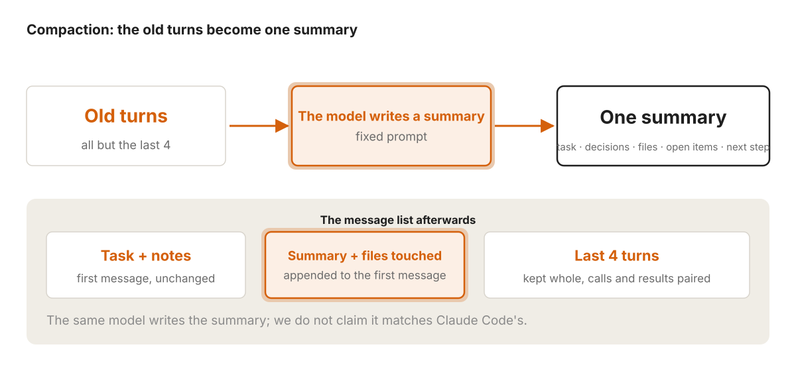
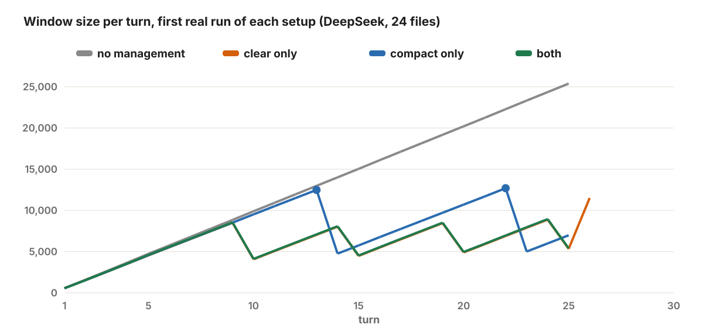

# Episode 5 · Context

*Part B · Trust and limits. Video: "Build your own agent · 05: context". Code: [`ep05/`](../ep05/).*

This article is the whole of episode 5 in writing, so you can follow it without the video. Every claim about Claude Code or the API is taken from the official pages linked inline. Where the docs are silent, I say "our version does it this way".

**What you will be able to do afterwards**

- Say what fills the context window, and why a long session gets worse as it fills.
- Count the window correctly from the numbers the API returns, including the cache fields.
- Clear old tool results, and compact old turns into a summary, without breaking the message list.
- Read a real comparison of four setups, and the two pitfalls it exposed.

**Before you start:** the agent from [episode 4](ep04-permissions.md). The code for this episode is a copy of `ep04/agent.py` plus a context manager. Run it only inside a throwaway folder.

---

## 1. The problem

Every turn, the agent sends the whole history to the model again: the system prompt, the notes, every message, every tool result. In a long task most of that is old tool output. The window is finite, and the model works worse as it fills. Anthropic's [context engineering post](https://www.anthropic.com/engineering/effective-context-engineering-for-ai-agents) calls this *context rot* and says context "must be treated as a finite resource with diminishing marginal returns". It describes a "performance gradient rather than a hard cliff", and gives no benchmark numbers.

The Claude Code docs list what shares the window: "conversation history, file contents, command outputs, CLAUDE.md, auto memory, loaded skills, and system instructions" ([How Claude Code works](https://code.claude.com/docs/en/how-claude-code-works)). In Claude Code, `/context` shows a grid of what is using it ([Commands](https://code.claude.com/docs/en/commands)).

Our test task makes the effect easy to see. The demo project is 24 Python files. Each file's first line names the next file; the agent must follow the chain, one file at a time, and list every TODO comment it passes (four of them, one in every sixth file). Each file read costs about 1,000 tokens.

<picture>
  <source media="(prefers-color-scheme: dark)" srcset="../docs/img/ep05-window-dark.svg">
  
</picture>

## 2. Counting the window

You cannot manage what you do not measure. The API returns usage numbers with every response. Our loop prints them every turn (`turn 7 tool_use | context 6482`).

There is a trap. On DeepSeek's Anthropic-compatible endpoint, the second call of a test returned `input_tokens=225`, but the window was really 1,633: `cache_read_input_tokens` was 1,408. The [Context windows page](https://platform.claude.com/docs/en/build-with-claude/context-windows) says "Cached prompt prefixes still occupy the context window". So the window is the sum of three fields:

<picture>
  <source media="(prefers-color-scheme: dark)" srcset="../docs/img/ep05-count-dark.svg">
  
</picture>

```python
def window_tokens(usage):
    return sum(getattr(usage, f, 0) or 0 for f in
               ("input_tokens", "cache_read_input_tokens", "cache_creation_input_tokens"))
```

The first version of our counter used `input_tokens` alone and showed a window of about 1,400 tokens for a run that was really growing past 20,000. The docs also have a separate counting endpoint, `POST /v1/messages/count_tokens`; the [Token counting page](https://platform.claude.com/docs/en/build-with-claude/token-counting) says its result is an estimate. We use the numbers each response already returns. For a rough number before a call, `estimate()` uses about 4 characters per token, which is our rule of thumb and not from the docs.

## 3. The lightest fix: clear old tool results

The same post calls tool result clearing "one of the safest lightest touch forms of compaction": once a tool was called deep in the history, why would the agent need the raw result again? The API has a beta feature for it, `clear_tool_uses_20250919`, which clears the oldest results first and leaves placeholder text ([Context editing](https://platform.claude.com/docs/en/build-with-claude/context-editing)).

Ours is a few lines. Keep the newest three tool results whole. Replace each older one with a sentence. The tool *calls* stay, so every call still has its result and the message list stays valid.

<picture>
  <source media="(prefers-color-scheme: dark)" srcset="../docs/img/ep05-clear-dark.svg">
  
</picture>

```python
CLEARED = "[old tool result cleared to save space; call the tool again if you need it]"
def clear_old_results(messages, keep=KEEP_RESULTS): ...
```

## 4. Compaction

Clearing keeps the structure but cannot shrink the model's own text and the placeholders, so a long enough task still fills the window. The second tool is compaction: ask the model to write a summary of the old turns, and replace them with it.

Ours, in `compact()`:

1. Find a cut point at an assistant message, so a call is never separated from its result. Keep the last four assistant turns whole.
2. Send the first message (task and notes) plus a transcript of the old turns, and a fixed prompt: keep the task, decisions made and why, files read or changed, what is finished, what is still open, and the next step; keep exact names and numbers; leave out raw tool output; be short.
3. The new message list is the first message with the summary and a list of files touched appended, followed by the recent turns.

<picture>
  <source media="(prefers-color-scheme: dark)" srcset="../docs/img/ep05-compact-dark.svg">
  
</picture>

What Claude Code does, from its docs: it "compacts automatically as you approach the limit" ([Context window](https://code.claude.com/docs/en/context-window)); the summary "keeps your requests and key code snippets, but detailed instructions from early in the conversation may be lost" (How Claude Code works). Afterwards the project `CLAUDE.md` and auto memory are re-injected from disk, and up to five files it read or edited are re-read, most recently modified first. `/compact` takes focus instructions, and a "Compact instructions" section in `CLAUDE.md` steers what is kept. The docs do not give the summary's format.

For recent models the docs also give a default compaction point: models with a 1M-token window compact "at about 967K tokens by default" (the [Model configuration page](https://code.claude.com/docs/en/model-config)). Our lines are demo settings, small on purpose so a short run reaches them: `agent.py` defaults to clearing above 6,000 tokens and compacting above 9,000, and the real runs below used 8,000 and 12,000. A real agent sets them from the model's window. The same model writes our summary, and I do not claim it is as good as Claude Code's.

## 5. Real runs: four setups, three runs each

The task above, `deepseek-flash`, 3 runs of each setup. Clear above 8,000 tokens, compact above 12,000 (`ep05/demos.py`; the logs and per-turn CSVs are in [`ep05/demo/repeat/`](../ep05/demo/repeat/)). The agent had only the `read_file` tool, so runs compare. "Correct" means all four TODOs were listed.

| Setup | Turns | Peak window | Correct |
|---|---|---|---|
| No management | 25, 25, 25 | 25,385 · 24,645 · 25,032 | 3 of 3 |
| Clear old results | 26, 53, 25 | 11,509 · 10,170 · 8,847 | 3 of 3 |
| Compact | 25, 25, 25 | 12,698 · 12,746 · 12,946 | 3 of 3 |
| Both switched on | 25, 28, 60 | 8,946 · 8,920 · 10,899 | 2 of 3 (the third hit the 60-turn limit with no answer) |

<picture>
  <source media="(prefers-color-scheme: dark)" srcset="../docs/img/ep05-chart-dark.svg">
  
</picture>

Read this honestly:

- Three runs of one model is a small sample. It does not tell you which setup is best.
- Compaction fired twice in each "compact only" run, and **never in any of the "both" runs**: with clearing on, the window stayed under the compaction line. So the "both" row says that clearing plus a compaction that never triggered finished 2 of 3. It does not test compaction working together with clearing.
- The 53-turn run and the 60-turn run show the model re-reading files it had already seen (next section).

## 6. Three pitfalls

**1. Clearing erased the only copy of what the agent found.** My first version only had the clearing step and no instruction about it. In that run the agent followed the chain to the last file, but the TODOs it had found were in tool results that had been cleared. It started again from the first file and ran into the 60-turn limit with no answer (`ep05/demo/long-clear-nonotes.csv`). The fix is a sentence in the system prompt: "Old tool results are cleared to save space, so write down what you find in your own reply before you move on." With it, the three "clear only" runs all answered, but one took 53 turns, so it is not a guarantee. The model's own text is not cleared, so that is where findings must live.

**2. Summaries lose decisions.** The docs warn that detailed early instructions "may be lost". Our summary prompt tells the model to keep decisions, and our runs did not test this, so I cannot show it failing. The practical rule from the docs ([Memory](https://code.claude.com/docs/en/memory)): instructions that must survive belong in `CLAUDE.md` (our `NOTES.md`), not only in the conversation.

**3. One huge output.** The docs say that if a single file or tool output is so large that the context refills right after each summary, Claude Code "stops auto-compacting after a few attempts and shows an error". Truncate big outputs in the tool, as in [episode 2](ep02-tools.md).

## 7. What this does not do

- Our lines are fixed numbers, not a fraction of the real window.
- The summary has no quality check. A wrong summary is believed forever by the agent.
- Clearing and compaction are tuned only on one task, one model and three runs each.
- No `/compact` command, no "compact instructions", and no rewind. Claude Code has all three.

## 8. Recap

1. Count the window with the API's numbers, and add the cache fields.
2. Clear old tool results first; it is the lightest fix.
3. Compact when that is not enough, and keep the task, decisions, files and next step.
4. Tell the model to write what it finds in its own replies, because tool results can disappear.

For an unrelated new task, the docs recommend `/clear` over a long session ([Context window](https://code.claude.com/docs/en/context-window)). **Next:** episode 6 adds plans and a task list.

**Try it:** run `python3 test_context.py` in `ep05/` (no API key needed), then change `CLEAR_AT` and `COMPACT_AT` in `demos.py` and watch the saw-tooth change.

## References

- Claude Code docs, Context window (what survives compaction, `/compact`, `/clear`): https://code.claude.com/docs/en/context-window
- Claude Code docs, How Claude Code works (what fills the window, what a summary keeps, huge outputs): https://code.claude.com/docs/en/how-claude-code-works
- Claude Code docs, Commands (`/context`, `/compact`, `/clear`, `/autocompact`): https://code.claude.com/docs/en/commands
- Claude Code docs, Model configuration (default compaction point): https://code.claude.com/docs/en/model-config
- Claude Code docs, Memory and Costs (keep `CLAUDE.md` short, put lasting rules there): https://code.claude.com/docs/en/memory · https://code.claude.com/docs/en/costs
- Anthropic engineering, Effective context engineering for AI agents (2025-09-29): https://www.anthropic.com/engineering/effective-context-engineering-for-ai-agents
- Claude API docs: Context windows, Token counting, Context editing: https://platform.claude.com/docs/en/build-with-claude/context-windows · https://platform.claude.com/docs/en/build-with-claude/token-counting · https://platform.claude.com/docs/en/build-with-claude/context-editing
- Code and real runs in this repository: [`ep05/agent.py`](../ep05/agent.py), [`ep05/test_context.py`](../ep05/test_context.py), [`ep05/demos.py`](../ep05/demos.py), [`ep05/demo/`](../ep05/demo/)
