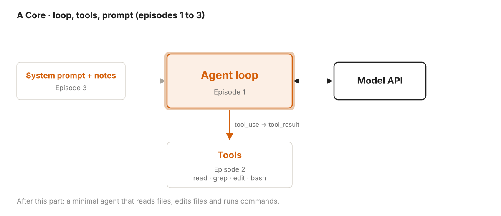

# A 核心 · 第 1 到 3 集

这一部分只做一件事：让一个循环跑起来，并且让它有手、有方向。

<picture>
  <source media="(prefers-color-scheme: dark)" srcset="img/part-a-dark.svg">
  
</picture>

**只需要 Python 和一个 API 密钥。**

## 这一部分的每一集

- **第 1 集 · 循环**（代码：`ep01/`）：调用模型，看 stop_reason，执行工具，追加结果，直到不再要工具。
- **第 2 集 · 工具**（代码：`ep02/`）：read_file、grep、run_bash、edit_file；工具说明就是给模型看的提示；出错也是一种结果。
- **第 3 集 · 系统提示和笔记文件**（代码：`ep03/`）：短的系统提示，加一个启动时读取的笔记文件，用固定任务比较改动前后。

## 学完以后你有什么

一个最小的 Agent：能读文件、改文件、跑命令，并按你写的规则行事。

回到[课程大纲](../SYLLABUS.md)或[项目首页](../README.md)。
