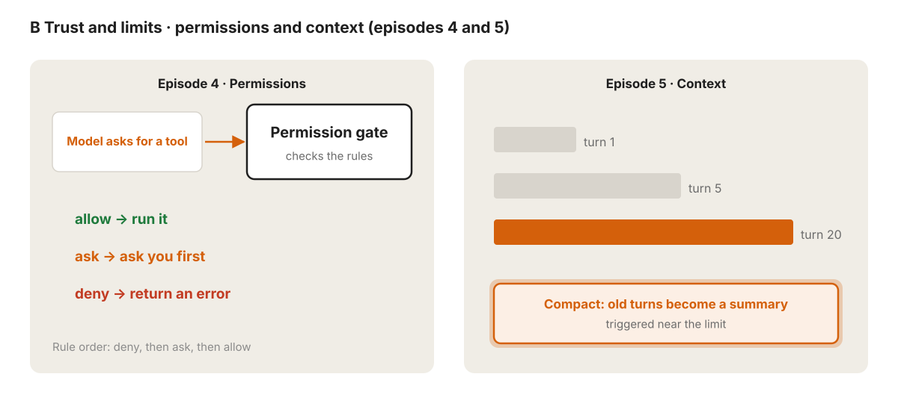

# B · Trust and limits (episodes 4 and 5)

Once an agent can run commands, two questions matter: what is it allowed to do, and how much can it still remember?

<picture>
  <source media="(prefers-color-scheme: dark)" srcset="img/part-b-dark.svg">
  
</picture>

**You need the code from part A.**

## Episodes in this part

- **Episode 4 · Permissions** (code: `ep04/`): A gate between the model's request and our code running it: allow, ask or deny. Also prompt injection: instructions inside a file are data, not orders.
- **Episode 5 · Context** (code: `ep05/`): Count tokens, trim oversized output, and compact old turns into a summary when the window fills.

## What you have afterwards

An agent you can leave running on your machine without worrying, and that survives long sessions.

Back to the [syllabus](../SYLLABUS.md) or the [project home](../README.md).
