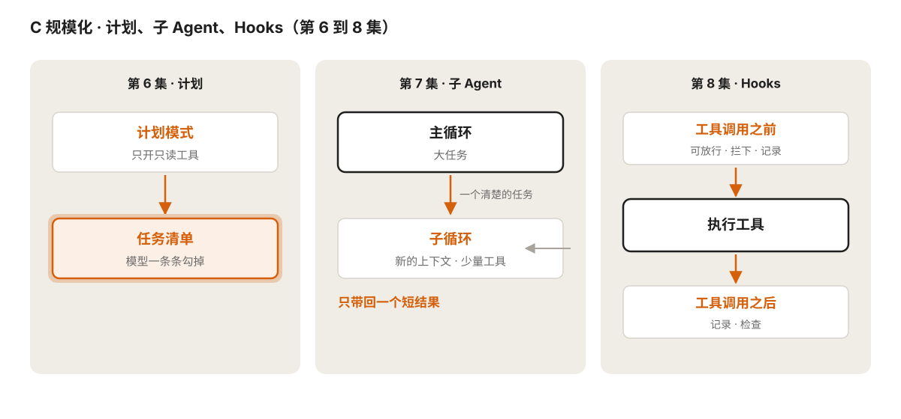

# C · Working at scale (episodes 6 to 8)

Bigger tasks need a way to plan, to split work up, and to insert your own checks at fixed points.

<picture>
  <source media="(prefers-color-scheme: dark)" srcset="img/part-c-dark.svg">
  
</picture>

**You need the code from parts A and B.**

## Episodes in this part

- **Episode 6 · Plans and task lists** (code: `ep06/`): Plan mode allows read-only tools; a task list lets the model tick items off one by one.
- **Episode 7 · Subagents** (code: `ep07/`): Give a side task a fresh context and bring back only a short result, so the main context stays clean.
- **Episode 8 · Hooks** (code: `ep08/`): Run your own code before and after a tool call: allow, block or log.

## What you have afterwards

An agent that handles large tasks, splits them up, and is bound by your own rules.

Back to the [syllabus](../SYLLABUS.md) or the [project home](../README.md).
