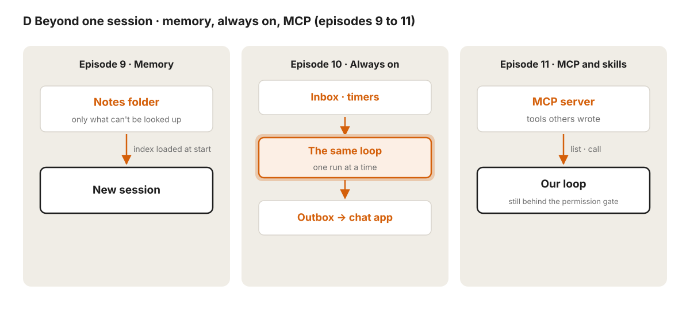

# D 跨会话 · 第 9 到 11 集

一个会话结束以后，Agent 还能记住什么，能不能在你不在的时候工作，能不能用别人写好的工具。

<picture>
  <source media="(prefers-color-scheme: dark)" srcset="img/part-d-dark.svg">
  
</picture>

**需要先完成 A 到 C 部分。**

## 这一部分的每一集

- **第 9 集 · 记忆**（代码：`ep09/`）：笔记文件夹只记查不到的东西；开始时加载索引；可选的离线整理。
- **第 10 集 · 一直在线**（代码：`ep10/`）：收件箱、定时器、守护进程里的循环、发件箱；没人批准时能做什么。
- **第 11 集 · MCP 和 skills**（代码：`ep11/`）：接入 MCP 服务器的工具，按需加载 skill 文件；这些工具同样要过权限闸门。

## 学完以后你有什么

一个会长期工作、会记事、也能接入外部工具的 Agent。

回到[课程大纲](../SYLLABUS.md)或[项目首页](../README.md)。
