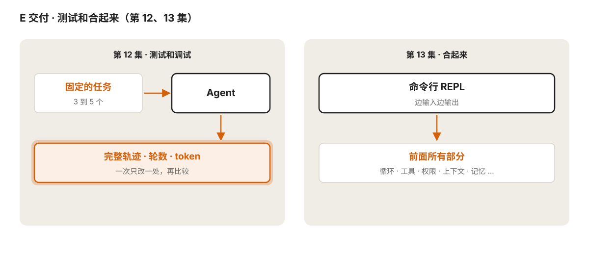

# E 交付 · 第 12、13 集

最后两集回答：怎么知道一个改动有没有变好，怎么把它们合成一个能用的命令行程序。

<picture>
  <source media="(prefers-color-scheme: dark)" srcset="img/part-e-dark.svg">
  
</picture>

**需要先完成 A 到 D 部分。**

## 这一部分的每一集

- **第 12 集 · 测试和调试**（代码：`ep12/`）：3 到 5 个固定任务，保存每一条消息，数轮数和 token，一次只改一处。
- **第 13 集 · 合起来**（代码：`ep13/`）：带流式输出的命令行 REPL，把所有部分接起来，并画出最终的架构图。

## 学完以后你有什么

一个完整的、约 500 行的命令行 Agent，加一套可以反复比较的测试。

回到[课程大纲](../SYLLABUS.md)或[项目首页](../README.md)。
